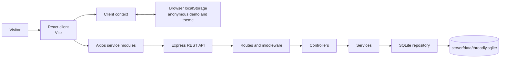

# Threadly

Threadly is a community-based social networking website inspired by the idea of topic-focused discussion spaces. It brings posts, conversations, and community discovery together in one responsive interface.

## Project Overview

The project separates a React/Vite client from an Express REST API. The API stores accounts and social records in a local SQLite database. MongoDB and Mongoose are intentionally deferred. The client retains an anonymous browser-local demo mode and uses the API for signed-in accounts.

## Problem Statement

General-purpose social feeds can make it difficult to find relevant discussions and build a sense of belonging around shared interests.

## Proposed Solution

Threadly organizes conversations into discoverable communities, with feeds, voting, comments, profiles, and saved posts to help people find and revisit discussions that interest them.

## Key Features

| Feature | Status |
|---|---|
| Account registration, login, and logout | Implemented with bcrypt password hashes and revocable JWT sessions |
| SQLite persistence | Implemented for accounts, Spaces, memberships, follows, posts, votes, bookmarks, comments, and notifications |
| Signed-in post and comment actions | Implemented through the API with ownership checks |
| Space membership and creation | Implemented through the API for signed-in users |
| Profile editing | Implemented for display name, bio, and location |
| Following and follow notifications | Implemented through the API |
| Anonymous demo interactions | Preserved; stored in browser `localStorage` |
| Search, popular, and trending feeds | Existing discovery experience preserved; API search and sorting available |
| Messaging, polls, uploads, moderation, and account preferences | Not implemented yet |
| Light and dark themes | Implemented; theme preference is stored in the browser |

The API database defaults to `server/data/threadly.sqlite` and is excluded from source control. Seed profiles are read-only demo accounts. New registered accounts are persistent and use the REST API for signed-in feed actions.

## Technology Stack

| Area | Technologies |
|---|---|
| Frontend | React 19, React Router, Vite |
| Styling and icons | Tailwind CSS v4, Lucide React |
| API client | Axios |
| Backend | Node.js, Express 5 |
| Persistence | Node.js built-in SQLite (`node:sqlite`) |
| Authentication | bcryptjs password hashes and HMAC-SHA256 signed JWT sessions |

## System Architecture



The anonymous UI remains available as a local demo; registered accounts use protected API operations persisted in SQLite. MongoDB and Mongoose integration remain deferred.

## Project Folder Structure

```text
Threadly/
├── client/
│   ├── public/
│   └── src/
│       ├── components/       # Layout, common, community, and post UI
│       ├── context/          # App state and theme state
│       ├── hooks/
│       ├── pages/            # React Router pages
│       ├── services/         # Axios API and browser-state services
│       └── utils/            # Sample content and shared helpers
├── server/
│   ├── config/
│   ├── controllers/
│   ├── data/                 # Sample seeds and local SQLite database
│   ├── middleware/
│   ├── repositories/         # SQLite persistence abstraction
│   ├── routes/
│   ├── services/
│   ├── utils/
│   ├── app.js
│   └── index.js
└── package.json              # Root convenience scripts
```

## Installation and Setup

Install the frontend and backend dependencies from the project root:

```bash
npm install --prefix client
npm install --prefix server
```

The server defaults to port `5000`; the Vite client defaults to port `5173`. Copy the optional environment templates to `.env` in their respective folders to customize settings. The server requires Node.js 22.13 or newer for built-in SQLite. In local development a signing secret is generated and persisted in SQLite; production must set a unique `JWT_SECRET` of at least 32 characters.

## Running the Application

Start each application in a separate terminal from the project root:

```bash
npm run dev:server
npm run dev:client
```

The client is available at `http://localhost:5173`, and the API defaults to `http://localhost:5000`. Check `GET http://localhost:5000/api/health` to verify the API.

Other root scripts:

```bash
npm run build       # Build the frontend
npm start           # Start the API server
npm run lint --prefix client
npm test --prefix server
```

## API Overview

All API routes are mounted under `/api`. Public reads include seeded sample content and account records. Signed-in mutations and account data persist in SQLite.

| Module | Public endpoints | Protected endpoint contracts |
|---|---|---|
| Health | `GET /health` | — |
| Authentication | `POST /auth/register`, `POST /auth/login` | `GET /auth/me`, `POST /auth/logout` |
| Users | `GET /users`, `GET /users/:userId`, `GET /users/:userId/posts`, followers/following | `PUT /users/profile`, `POST` / `DELETE /users/:userId/follow` |
| Communities | `GET /communities`, `GET /communities/:communityId` | `POST /communities`, `POST` / `DELETE /communities/:communityId/join` |
| Posts | `GET /posts`, `GET /posts/:postId`, `GET /posts/:postId/comments` | `POST /posts`, `PUT` / `DELETE /posts/:postId`, votes, bookmarks, saved posts, comments |
| Comments | — | `POST /comments/:commentId/replies`, `PUT` / `DELETE /comments/:commentId`, comment votes |
| Notifications | — | `GET /notifications`, `PATCH /notifications/:notificationId/read` |
| Search | `GET /search?q=term` | — |

Post and user-post listings support `page`, `limit`, and `sort` (`latest`, `popular`, or `trending`). See [server/README.md](./server/README.md) for request body examples, response shapes, and error details.

## Screenshots

No screenshots are currently included. Add presentation-ready images under `docs/screenshots/` and link them here when available.

## Remaining Work

- Profile picture/cover uploads, account preferences, and username changes.
- User blocking/reporting, moderation, and administrator workflows.
- Direct messages, polls, hashtag/mention discovery, and real-time notifications.
- Backend-driven infinite-feed pagination and richer search filters.
- Expanded authorization and API coverage for all moderation and account settings.

## Contributors

Contributor names were not provided for this repository. Add the project contributors here when confirmed.
