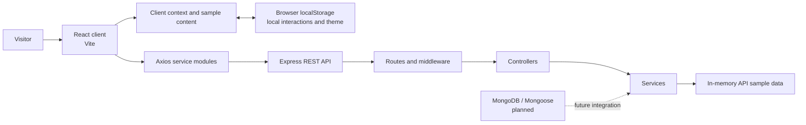

# Threadly

Threadly is a community-based social networking website inspired by the idea of topic-focused discussion spaces. It brings posts, conversations, and community discovery together in one responsive interface.

## Project Overview

The project separates a React/Vite client from an Express REST API. The client currently uses bundled sample content and browser `localStorage` for interactive posts and community actions. The API has separate in-memory sample data for development and testing. Neither data source is MongoDB-backed.

## Problem Statement

General-purpose social feeds can make it difficult to find relevant discussions and build a sense of belonging around shared interests.

## Proposed Solution

Threadly organizes conversations into discoverable communities, with feeds, voting, comments, profiles, and saved posts to help people find and revisit discussions that interest them.

## Key Features

| Feature | Status |
|---|---|
| Community discovery and browsing | Implemented with sample content |
| Community creation | API route prepared; unavailable until authentication is implemented |
| Create, edit, and delete posts | Implemented in the browser for posts created by the current local profile |
| Upvotes and downvotes | Implemented in the browser |
| Comments and nested replies | Implemented in the browser |
| Join and leave communities | Implemented in the browser |
| Saved posts | Implemented in the browser |
| Search, popular, and trending feeds | Implemented using sample content |
| User profiles | Implemented with sample content |
| Light and dark themes | Implemented; theme preference is stored in the browser |

Browser-side social interactions are saved in `localStorage` on that device and are not synchronized to the API or other users. API-side sample data is held in memory and resets when the server restarts.

## Technology Stack

| Area | Technologies |
|---|---|
| Frontend | React 19, React Router, Vite |
| Styling and icons | Tailwind CSS v4, Lucide React |
| API client | Axios |
| Backend | Node.js, Express 5 |
| Planned persistence | MongoDB with Mongoose (not integrated) |

## System Architecture



The frontend and backend are separate applications. The client renders the interface and currently handles interactive social features with local browser state. The API exposes public sample-data reads and prepared route contracts; protected requests return `501 AUTH_NOT_CONFIGURED`. MongoDB and real authentication have not been implemented.

## Project Folder Structure

```text
Threadly/
├── client/
│   ├── public/
│   └── src/
│       ├── components/       # Layout, common, community, and post UI
│       ├── context/          # App state and theme state
│       ├── hooks/
│       ├── pages/            # React Router pages
│       ├── services/         # Axios API and browser-state services
│       └── utils/            # Sample content and shared helpers
├── server/
│   ├── config/
│   ├── controllers/
│   ├── data/                 # Temporary in-memory sample data
│   ├── middleware/
│   ├── models/               # Reserved for future persistence models
│   ├── routes/
│   ├── services/
│   ├── utils/
│   ├── app.js
│   └── index.js
└── package.json              # Root convenience scripts
```

## Installation and Setup

Install the frontend and backend dependencies from the project root:

```bash
npm install --prefix client
npm install --prefix server
```

The server defaults to port `5000`; the Vite client defaults to port `5173`. Optional environment templates are provided at `client/.env.example` and `server/.env.example`. Copy them to `.env` in their respective folders to customize settings. The MongoDB and JWT values in the server template are placeholders for planned work and are not currently used to provide persistence or authentication.

## Running the Application

Start each application in a separate terminal from the project root:

```bash
npm run dev:server
npm run dev:client
```

The client is available at `http://localhost:5173`, and the API defaults to `http://localhost:5000`. Check `GET http://localhost:5000/api/health` to verify the API.

Other root scripts:

```bash
npm run build       # Build the frontend
npm start           # Start the API server
npm run lint --prefix client
```

## API Overview

All API routes are mounted under `/api`. Public reads return development sample data; the API does not persist changes. Protected operations are intentionally unavailable until real authentication is added and currently return `501 AUTH_NOT_CONFIGURED`.

| Module | Public endpoints | Protected endpoint contracts |
|---|---|---|
| Health | `GET /health` | — |
| Authentication | `POST /auth/register`, `POST /auth/login` (currently return 501) | `GET /auth/me` (currently returns 501) |
| Users | `GET /users`, `GET /users/:userId`, `GET /users/:userId/posts` | `PUT /users/profile`, `POST` / `DELETE /users/:userId/follow` |
| Communities | `GET /communities`, `GET /communities/:communityId` | `POST /communities`, `POST` / `DELETE /communities/:communityId/join` |
| Posts | `GET /posts`, `GET /posts/:postId`, `GET /posts/:postId/comments` | `POST /posts`, `PUT` / `DELETE /posts/:postId`, `POST /posts/:postId/vote`, `POST /posts/:postId/bookmark`, `POST /posts/:postId/comments` |
| Comments | — | `POST /comments/:commentId/replies`, `DELETE /comments/:commentId` |
| Notifications | — | `GET /notifications`, `PATCH /notifications/:notificationId/read` |
| Search | `GET /search?q=term` | — |

Post and user-post listings support `page`, `limit`, and `sort` (`latest`, `popular`, or `trending`). See [server/README.md](./server/README.md) for request body examples, response shapes, and error details.

## Screenshots

No screenshots are currently included. Add presentation-ready images under `docs/screenshots/` and link them here when available.

## Future Enhancements

- Integrate MongoDB and Mongoose for persistent users, communities, posts, votes, comments, and notifications.
- Implement password hashing, JWT authentication, and authorization.
- Connect client interactions to authenticated API endpoints and synchronize state across devices.
- Enable community creation and add automated frontend and API tests.

## Contributors

Contributor names were not provided for this repository. Add the project contributors here when confirmed.
